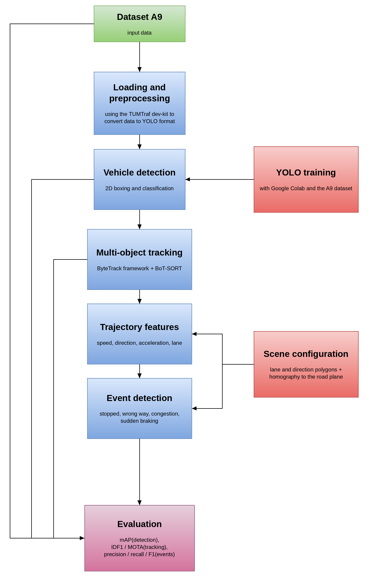
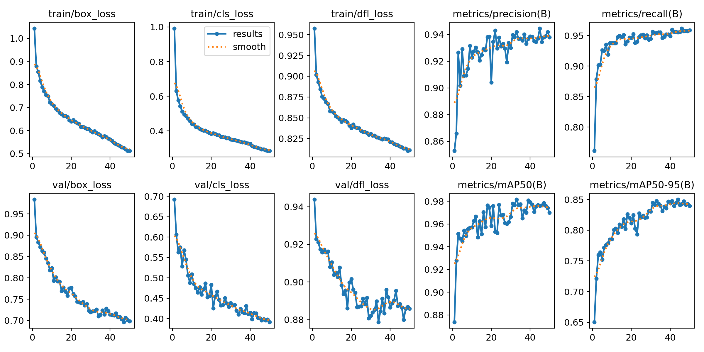
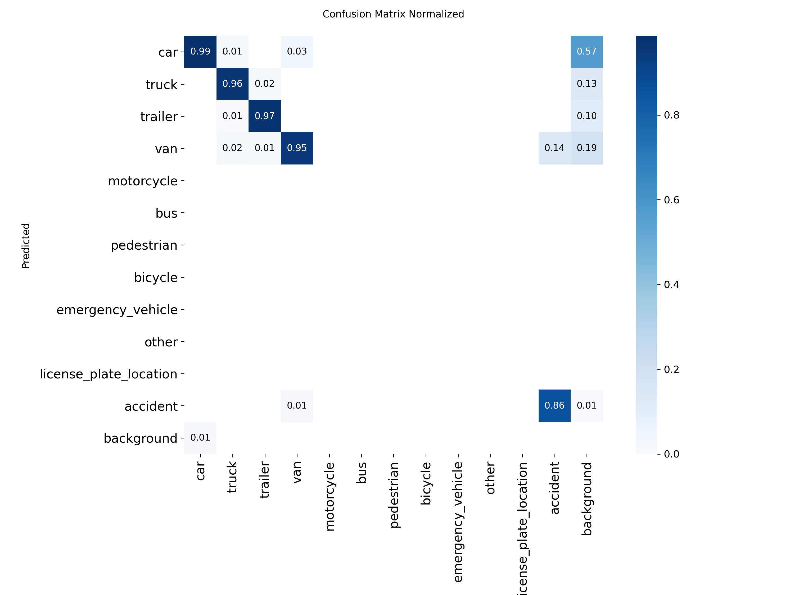
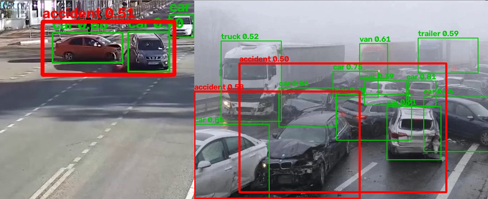
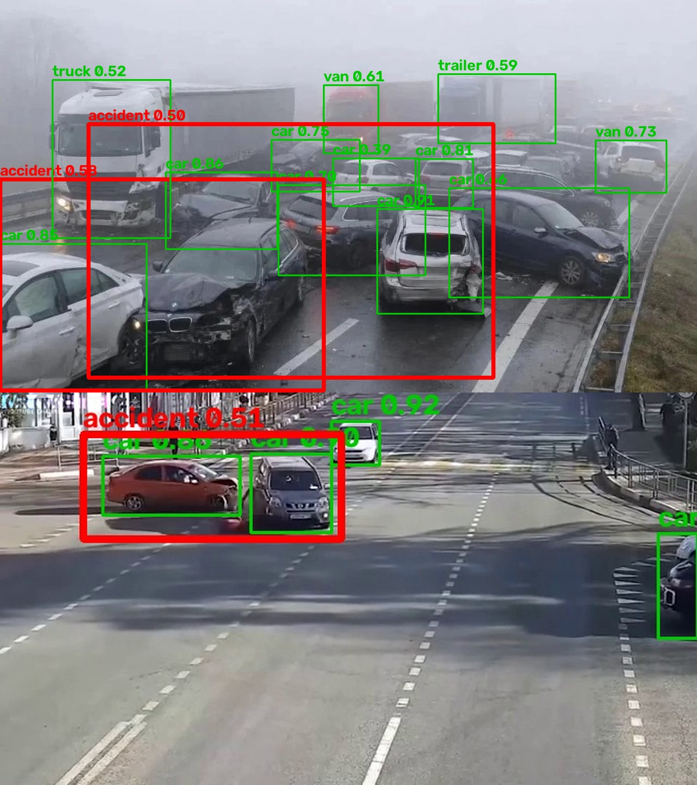
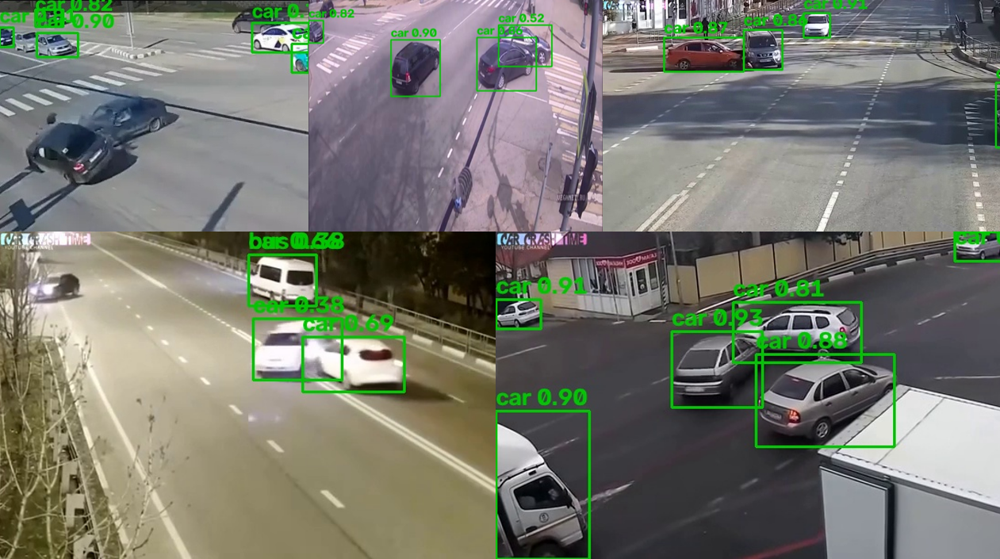
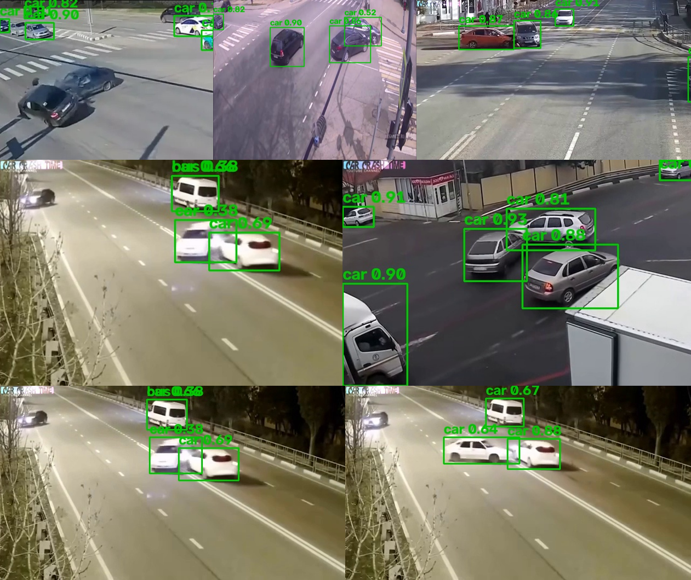

# Traffic Event Detection

## Existing Solutions

| No. | Author(s) / Year | Project / Article Title | Application / Field | Used Technologies | Methodology / Approach | Results | Limitations | Additional Comments |
| --- | --- | --- | --- | --- | --- | --- | --- | --- |
| 1 | B. Shyamala Gowri, Harini Harisitha S, Abishek Kanna M, Amirthavarshini N S / 2025 | You Only Look Once Version 8 (YOLOv8)-Driven Emergency Vehicle Detection and Graph Neural Networks (GNNs) based Traffic Signal Prioritization | Traffic Management System in case of emergency | Dashcams, drones and surveillance cameras are used to acquire data. The YOLOv8 (You Only Look Once) algorithm is used for object detection and GNN (Graph Neural Network)-based learning to dynamically adjust traffic signals. | The YOLOv8 algorithm is trained to detect emergency vehicles, DeepSORT tracks objects in real time across multiple frames and TensorRT and ONNX Runtime are used to optimize latency. GNNs analyze traffic flows and adjust traffic signals to prioritize emergency vehicles. | 40% reduction in emergency vehicle response time and 35% improvement in traffic flow, alongside 94.1% detection accuracy. | The cost for integration into existing infrastructure may be substantial and the solution has not been tested in real urban traffic as of yet. | The solution presented in this article uses the YOLO algorithm, the same algorithm family used in our project. The information detected using this method can be adapted to detect accidents and other events. |
| 2 | Hilman Taris Muttaqin, Ema Rachmawati, Edward Ferdian / 2024 | Toward End-to-End Detection for Traffic Accidents from CCTV Footage | Traffic Accidents Detection | CCTV recordings, roleplay using games and the MSCOCO Vehicle dataset provide training data for the DETR (Detection Transformer) algorithm. The AI training has been done using an Nvidia V100 / T4 GPU. | DETR is based on the concepts of end-to-end object detection, which combines spatial and contextual information, in order to generate better predictions for object class and location. The algorithm has multiple components: the backbone extracts features from the input image, the encoder separates objects in the image, the decoder identifies up to 100 objects simultaneously, the prediction heads predict an object's class, coordinates and the box's dimensions, before the items are compared against the ground truth. | Although the DETR algorithm (with Non-Maximum Suppression) has the lowest Average Precision (AP) when compared to Faster R-CNN and YOLOv3, it has the lowest detection of false negatives (vehicles) and false positives (accidents) out of these three. | This study only detects accidents in vehicles that have four or more wheels and only using footage from outside the viewpoint of the vehicle. | This article addresses the same problem that we are trying to solve, using a different algorithm than the one we use. |
| 3 | Rekha R. Nair, Tina Babu, Kishore S., Novy Jacob, Kalidasan A. S. / 2025 | Automated Traffic Signal Violation Detection and Real-Time Notification System for Enhanced Road Safety | Traffic Violation and Accident Detection | CCTV cameras are used for data collection. GPS provides the location and messaging applications and automatted phone calls are used to notify the authorities. | Firstly, the algorithm separates the foreground from the background, then it sets two offset lines and one threshold line. Once an object passes those lines, it is detected as an accident or violation. Lastly, the information regarding the event is sent to the authorities. | The authors claim that their model effectively identifies incidents in real time and notifies the relevant authorities, but they do not provide any statistics to prove its efficiency. | Some objects were not detected when MOG2 (Mixture of Gaussians) was used. The article does not provide any quantifiable data to prove their claims and does not say how the model differentiates an accident from a traffic violation. | This article illustrates how a system like ours (that detects accidents and other events) may be useful in real-life scenarios. The authors could have provided more data, such as the accuracy of the identification process. |
| 4 | Hadi Ghahremannezhad, Hang Shi, Chengjun Liu / 2023 | Object Detection in Traffic Videos: A Survey | Object Detection | Traffic cameras, motion-based methods (Frame Differencing, Optical Flow, Background Modeling) and appearance-based methods (Methods Based on Handcrafted Features, Methods Based on CNNs - Convolutional Neural Networks and Methods Based on Transformers) | This article classifies different object detection models and algorithms, such as Locating Objects Based on Hand-Crafted Features, Region-based CNN and YOLO. | This article is a survey that states the advantages and disadvantages of some popular object detection methods. The results vary from method to method. One of the best algorithms for real-time detection is the YOLO algorithm. | Motion-based methods are less suited for applications that use non-stationary cameras, they fail to detect moving objects after those objects stop and are sensitive to weather and illumination changes. Meanwhile, appearance-based methods could detect a high number of false positives, some of them have a low processing speed and they require a large dataset for training. | Although it is only a survey, this article provides an extensive overview of the methods used for object detection, which helped us choose a method that is suitable for our project. |
| 5 | Sarvesh Shirulkar, Rishabhdev Makode, Richa Khandelwal / 2025 | Adaptive Traffic Signal Management Using Real-Time Vehicle Detection and Tracking | Adaptive Traffic Signal Management | The dataset consists of CCTV footage and Shutterstock videos. The YOLO algorithm is used to detect vehicles. | The YOLO algorithm is used to detect vehicles, such as cars, motorcycles and trucks. The detection area is defined using bounding boxes and excludes irrelevant areas, in order to minimize the number of false positives. Every vehicle type is assigned a certain weight, called a PCU (Passenger Car Unit), based on its size. The green signal duration is calculated using the following formula: G = B + (P x E), where B = Base Time, P = Total PCU count, E = Extra time per PCU. Interconnection logic is also applied to coordinate signals for adjacent lanes. | This method improves the overall efficiency by about 10% when compared to traditional traffic signal systems. The cycle time was reduced from 120 to 107 seconds during a simulation. The system also proved to be most effective for high-density areas, reducing the waiting time by up to 40%. | The authors claim to have used a diverse set of traffic conditions, but the dataset is not standardized. The algorithm does not always detect objects that are partially or fully covered by other vehicles. Moreover, the system is affected by adverse weather conditions. These problems could be overcome by including LiDAR or radar sensors to supplement vision-based detection. The system was only simulated and not tested in real-life conditions. | The solution presented in this article uses the YOLO algorithm, the same algorithm family used in our project. The authors mention that this method could be adapted to detect accidents and other events. |

## Project Architecture

The system is a modular pipeline for detecting traffic accidents from fixed highway cameras, using the A9 dataset (TUMTraf). Accidents are detected directly by a YOLOv8 model with an additional `accident` class.

### Modular Diagram


Implemented modules:

| # | Module | What it does |
| --- | --- | --- |
| 1 | Dataset A9 | Fixed-camera TUMTraf sets: `R0_S0` (contains the accident), `R0_S1` and `R0_S2` (no accidents, used as negative examples) |
| 2 | Loading and preprocessing | TUMTraf dev-kit converts the A9 labels to YOLO format; the `accident` class is added (see below) |
| 3 | YOLO training | YOLOv8s (COCO-pretrained), 50 epochs, `imgsz=960`, trained in Google Colab on a time-based split. Extra data (Roboflow, TUMTraf Event) goes to the training set only; vehicles in the Roboflow images are pseudo-labeled with a COCO-pretrained YOLOv8x |
| 4 | Vehicle and accident detection | `best.pt` detects vehicles and the `accident` class |
| 5 | Post-processing | The accident box is expanded to cover the involved vehicles, and a per-camera verdict is given |
| 6 | Outputs and evaluation | Annotated images, `detections.csv` (frame, timestamp, confidence, involved vehicles, box), mAP and confusion matrix |

Planned modules (shown in the diagram, not implemented yet): multi-object tracking (ByteTrack / BoT-SORT), trajectory features (speed, direction, acceleration, lane), scene configuration (lane polygons, homography) and event detection (stopped vehicle, wrong way, congestion, sudden braking).

## What Is an Accident in This Project

The `accident` class is a **heuristic label** derived from the A9 annotations, not a ground-truth annotation. The rules live in section 5 of `YOLOv8/Yolov8_training.ipynb`.

- **Contact:** two objects whose 3D boxes (top view, rotated by `rotationYaw`) intersect. A truck and its own trailer do not count.
- **Start:** the first frame where the contact lasts at least `MIN_CONTACT_FRAMES` (3) consecutive frames. Earlier frames have no accident label.
- **Label:** from then on, the `accident` box is the **union of the 2D boxes of the involved vehicles**, so it is larger than a single car.
- **Sets without 3D boxes (R0):** the vehicles that stopped first on the roadway are the involved ones. A group counts as an accident if at least `MIN_CUES` (2) cues hold: abnormal pose, sudden stop, several early stops, traffic stopped behind, overlap at the stop.

## How an Accident Is Detected in Code

1. **Labels:** `contact_set()` and `accident_boxes()` (notebook) generate the `accident` boxes while converting A9 to YOLO format.
2. **Training:** YOLOv8s learns `accident` as the 12th class, next to `car`, `truck`, `trailer`, `van`, `motorcycle`, `bus`, `pedestrian`, `bicycle`, `emergency_vehicle`, `other` and `license_plate_location`.
3. **Inference (`YOLOv8/main.py`):** `model.predict` runs with a general threshold (`--conf`, default 0.25) and a separate threshold for the accident class (`--acc-conf`, default 0.35). The verdict is positive if at least one `accident` box reaches `--acc-conf`:

```python
acc = [c for name, c, _ in dets if name == 'accident' and c >= acc_conf]
```

4. **New test sets (notebook, section 10):** the predicted accident box is expanded over the nearby vehicles (`INVOLVED_MARGIN = 0.10`), and a camera gets an ACCIDENT verdict only after `MIN_DET_FRAMES = 3` consecutive detections (one missed frame is tolerated). Results are saved to `detections.csv`.

## Usage

```bash
pip install ultralytics opencv-python
cd YOLOv8
python main.py --folder path/to/images --weights best.pt          # random image from a folder
python main.py --image photo.png --weights best.pt --acc-conf 0.4   # one image
```

The script prints the detected objects and either `ACCIDENT DETECTED (confidence ...)` or `No accident detected.`, and saves an annotated image (`result.jpg` by default). Red box = accident, green boxes = other objects.

`YOLOv8/video2img_converter.py` extracts frames from videos placed in `YOLOv8/videos` (one frame every 0.1 s by default), in an A9-like folder structure, so that new footage can be tested.

## Evaluation

- **Split:** time-based and common to all cameras of a set (each phase is divided into 10 time blocks; blocks 5 and 10 go to validation), so almost identical neighbouring frames do not leak between train and validation. Accident frames in the training set are repeated twice.
- **Validation:** A9 only. Metrics are mAP and the confusion matrix (`YOLOv8/Results/`).
- **Results (A9 validation):** mAP50 is approximately 0.97 and mAP50-95 approximately 0.84. In the normalized confusion matrix, 86% of the `accident` boxes are detected as `accident`.

> The validation split comes from the same scenes as the training split, so these numbers are optimistic. Qualitative tests on unseen footage (below) are the more honest check.




## Examples

### Correctly detected
The red box is the `accident` class (confidence 0.50-0.58), the green boxes are vehicles. It works for a simple collision and for a multi-vehicle pile-up in fog. On the pile-up, two overlapping accident boxes appear, but the verdict is still correct.





### Missed accidents
Vehicles are detected (green boxes), but no `accident` box appears. These frames come from footage that differs from the A9 training domain (camera angle, night, external video compilations). The same intersection (orange car and dark SUV) is detected in one frame and missed in another, so a single frame is not reliable, which is why the verdict on new test sets requires several consecutive frames.




## Limitations and Future Work

- Only one accident event in A9 (about 309 frames), so the model has seen few accident scenes.
- The accident labels are heuristic, not ground truth.
- Rare classes (bus, pedestrian, bicycle) are barely represented.
- Next steps: more accident data with pseudo-labeling, tuning `ACC_CONF` and `INVOLVED_MARGIN`, confirmation over several frames through tracking, and the planned event modules (stopped vehicle, wrong way, congestion, sudden braking).
